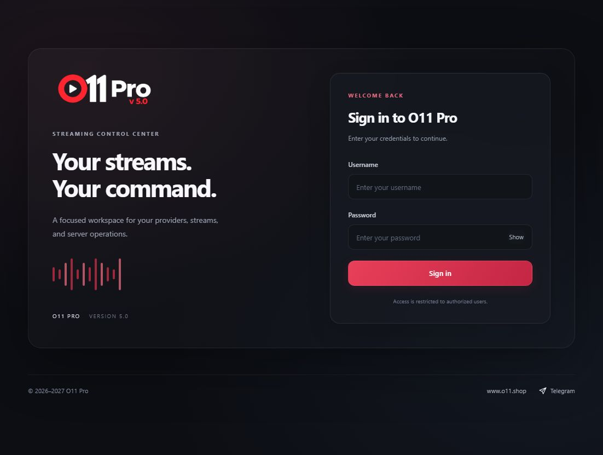
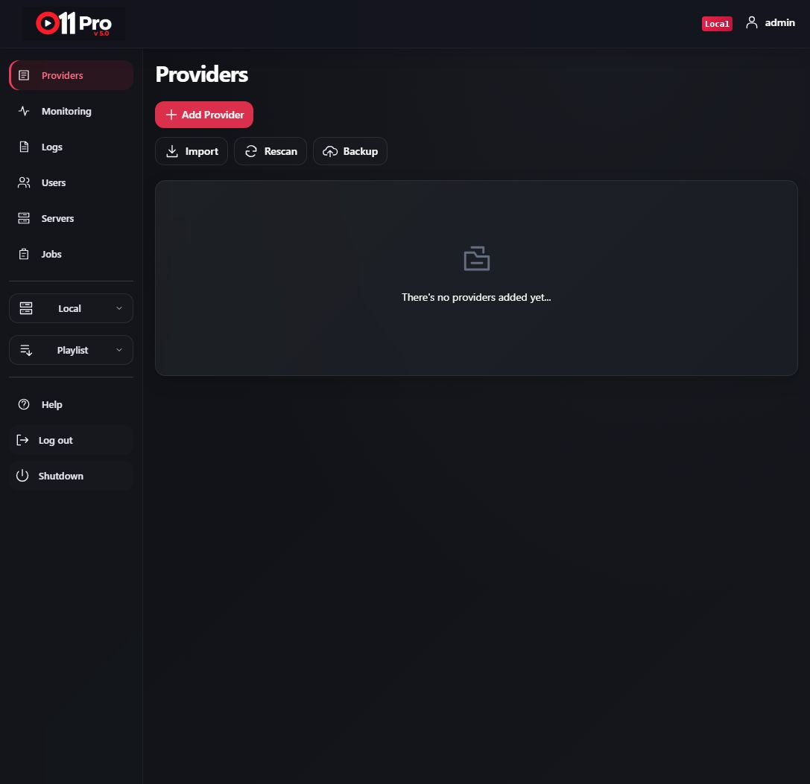
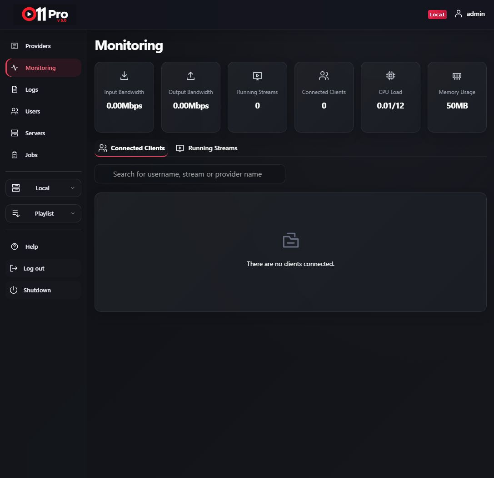
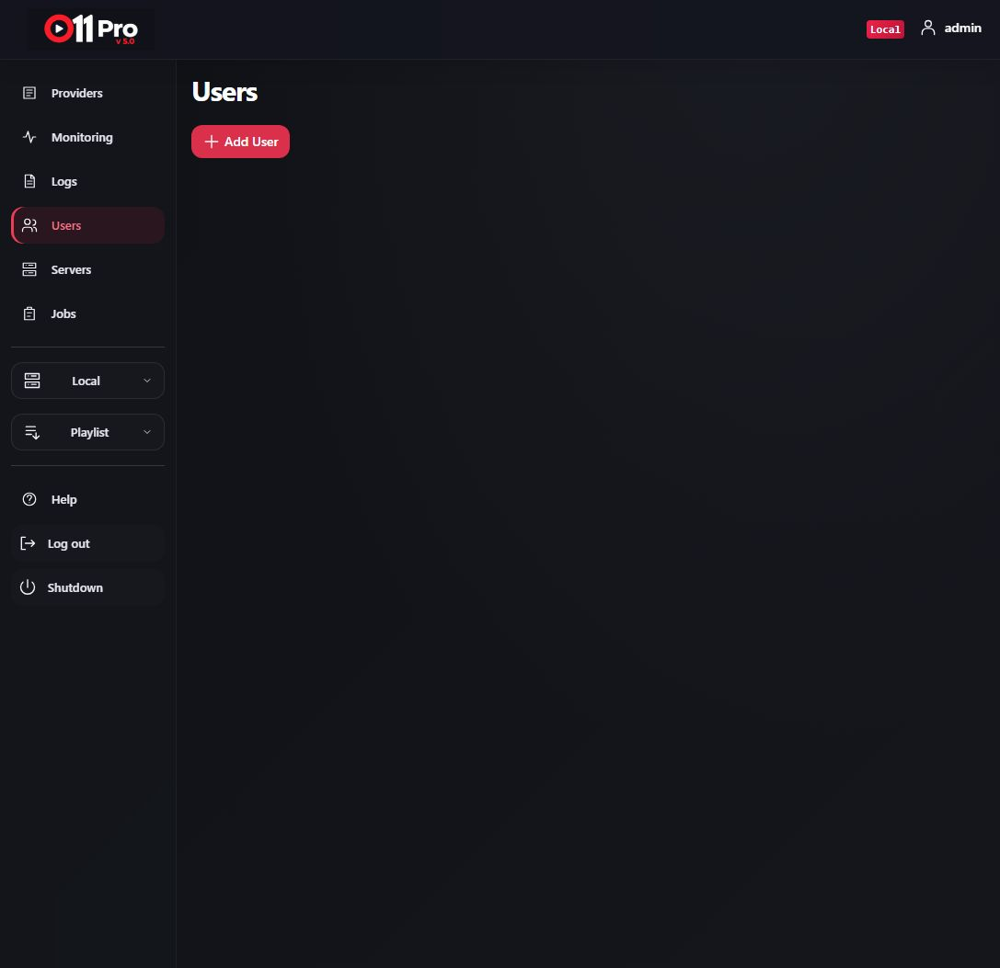
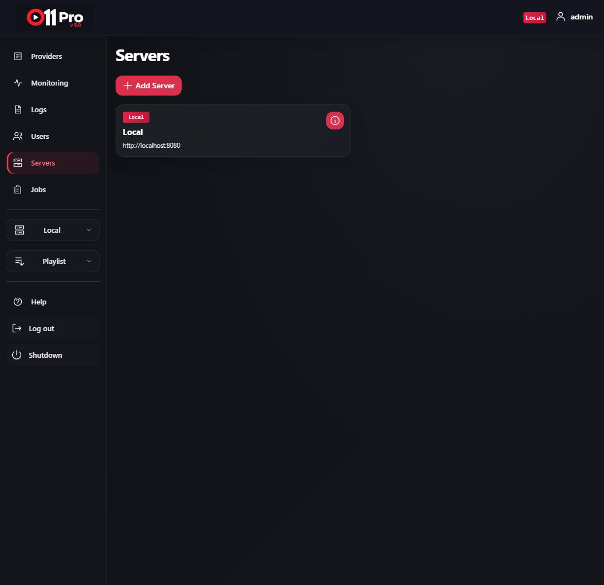
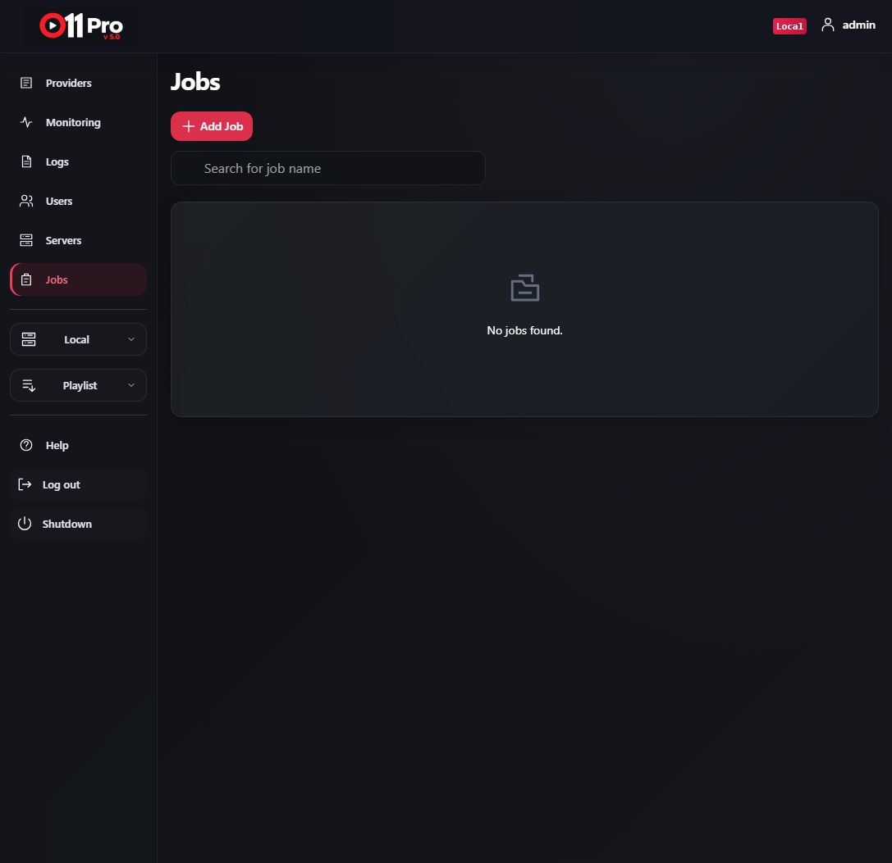

# O11 Pro v5.0


Linux x86-64 · Version 5.0 · Portable archive and systemd installer

**Open [README.html](README.html) for the installation guide and full screenshot gallery.**

Open [HELP.html](HELP.html) for the Help Center covering workspace functions, playback checks, maintenance, and troubleshooting. The same help is available at `/help` in the application.

## Portable Linux x86-64 release

[Download the portable archive](https://github.com/drmforall/O11-Pro-v5.0-Linux-x64/releases/download/v5.0.0-portable/O11-Pro-v5.0-Linux-amd64-Portable.tar.gz). It runs O11 Pro v5 without installing Go or creating a systemd service. The archive contains one executable with the O11 backend and web assets, plus an optional launcher that checks the host before starting it.

### Compatible hosts

Use a **Linux x86-64 host with glibc**, the loader `/lib64/ld-linux-x86-64.so.2`, and FFmpeg. The package was tested on Ubuntu 24.04 x86-64. Other distributions have not been verified. ARM64 and musl-only systems such as a standard Alpine Linux installation are not supported by the included backend. The Go wrapper is statically linked, but the embedded backend still needs the host's glibc loader and libraries.

### Extract and verify

```sh
tar -xzf O11-Pro-v5.0-Linux-amd64-Portable.tar.gz
cd O11-Pro-v5.0-Linux-amd64-Portable
sha256sum -c SHA256SUMS.txt
```

All three files should report `OK`. The archive preserves executable permissions. Install FFmpeg with your distribution's package manager; on Ubuntu or Debian, run `sudo apt install ffmpeg`.

### Start

```sh
./run.sh
```

The launcher prompts for an admin username and hidden password. It stores data in `~/o11v5-data`, listens on `127.0.0.1:8080`, and runs in the foreground. Open `http://localhost:8080/login` on the host. Press **Ctrl+C** to stop it. The account running O11 needs a writable data directory and user cache. The backend is extracted into `~/.cache/o11-pro-v5`, or beneath `XDG_CACHE_HOME` when set.

| Variable | Default | Purpose |
| --- | --- | --- |
| `O11_PORT` | `8080` | HTTP port |
| `O11_BIND` | `127.0.0.1` | Listen address |
| `O11_DATA_DIR` | `~/o11v5-data` | Persistent application data |
| `O11_ADMIN_USER` | Prompt | Admin username for unattended start |
| `O11_ADMIN_PASSWORD` | Prompt | Admin password for unattended start |

Set optional variables before running `./run.sh`. You can also run `./o11pro-v5` directly with its normal O11 command-line options.

### Remote access

Leave the listener on `127.0.0.1`. From another computer, create an SSH tunnel:

```sh
ssh -L 8080:127.0.0.1:8080 USER@SERVER
```

Then open `http://localhost:8080/login` on your computer. Replace `USER` and `SERVER` with your SSH account and server address. Use an authenticated HTTPS reverse proxy for ongoing public access.

### Security and data

The O11 backend receives its credentials as command-line arguments, which may be visible to other users on the host while O11 runs. `run.sh` hides password input. Keep `O11_DATA_DIR` when updating or moving the binary. This archive does not install, update, or stop an existing O11 service.

## Systemd installer

```bash
sudo apt install python3 ffmpeg unzip
unzip O11-Pro-v5.0-Linux-x64.zip -d o11v5
cd o11v5
sudo bash install.sh
```

Requires systemd. The installer prompts for an admin username, hidden password (12+ characters), confirmation, and an available port. Open `http://localhost:8080/login` using your selected port. No default password is supplied. Existing installations are not overwritten.

## Operate installed service

```bash
sudo systemctl status o11v5
sudo journalctl -u o11v5 -n 50 --no-pager
```

Data: `/var/lib/o11v5` · Credentials: `/etc/o11v5.env` (root-only) · Binary: `/opt/o11v5/o11pro-v5`.

The installed server listens on loopback. Configure an HTTPS reverse proxy for remote access. Python maintenance tools are optional and not automatically scheduled. Read the HTML guide for scope and service-name requirements. The binary is compiled and stripped, not encrypted.

## Screenshots

Actual captures from a fresh local workspace.

| Login | Providers |
|---|---|
|  |  |

| Monitoring | Users |
|---|---|
|  |  |

| Servers | Jobs |
|---|---|
|  |  |

[Website](https://www.o11.shop) · [Telegram](https://t.me/Playreadydrm?direct)

© 2026–2027 O11 Pro
